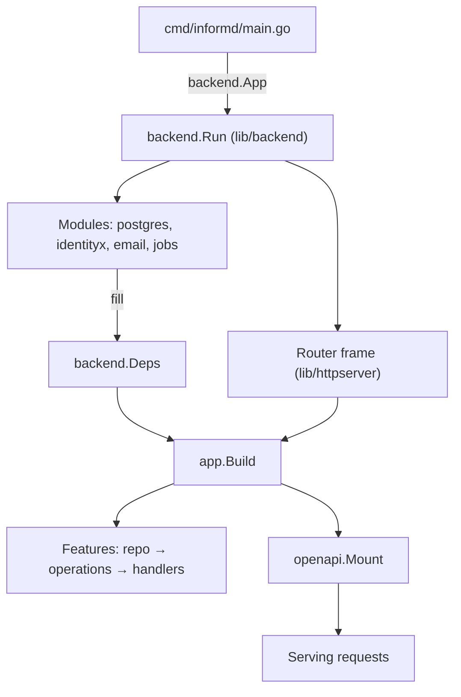

# How a backend is built

- **Order:** 1
- **Summary:** The shape every Go backend shares, on one page, and where to read next.

IdentityX, Payssage, Informd and Univents do different jobs, but they're built the same way. Each one is a small `main` that describes the backend, and a shared kit in `lib/go` that boots it, serves it and shuts it down. If you understand one backend, you can find your way around the other three.

These pages cover that shared shape. What a single service does lives in its own docs, under Services. How a request gets from the browser to a container is in [Architecture](/docs/onboarding/architecture), and the folder layout is in [Repo tour](/docs/onboarding/repo-tour). Those pages explain the infrastructure. These ones explain the Go code that runs inside the container.

## The whole thing in one picture

1. **`main`** loads the config from the environment and hands `backend.Run` a `backend.App`: the name, the spec, the modules it needs, a `Build` function and the error mapper.
2. **`backend.Run`** starts telemetry, opens each module in order, builds the router frame (middleware, `/health`, `/docs`, `/problems`) and calls `Build`.
3. **Modules** open shared infrastructure, like the database pool or the IdentityX client, and put it in a plain `Deps` struct.
4. **`Build`** is the backend's own wiring. It makes the repos, gives each feature its operations, and mounts the generated server on the router.
5. **The generated server** turns each spec operation into a route. It runs it through the same strict middleware every backend uses, then calls a feature's handler.

There's no dependency injection framework and no reflection. The module list is the boot order, and `Build` is ordinary Go you can read top to bottom.

## The ideas that hold it together

- **The spec comes first.** Each feature declares its routes and errors in its own `spec.yml`. The server code, the error types and the TypeScript clients are all generated from it. See [The spec drives the code](/docs/backend/spec-and-codegen).
- **A feature is one folder.** Its repo, operations, handlers and spec sit together in `internal/features/<name>`. See [Features](/docs/backend/features).
- **Errors have names.** Code returns a named Go error, and one mapper turns it into an RFC 9457 problem. See [Errors](/docs/backend/errors).
- **The harness owns the plumbing.** Middleware, tracing, validation, the error shape and the boot all live in `lib/go`, written once. A backend can't drift from the others because it doesn't have its own copy.

## Reading order

<Cards>
  <Card title="From main to the first request" href="/docs/backend/boot-walkthrough">A boot traced line by line, with the real code.</Card>
  <Card title="The spec drives the code" href="/docs/backend/spec-and-codegen">What just gen builds, and from what.</Card>
  <Card title="A request, end to end" href="/docs/backend/request">Every layer a request passes on its way in and out.</Card>
  <Card title="Features" href="/docs/backend/features">One folder, a Deps struct, and how features share data.</Card>
  <Card title="Errors" href="/docs/backend/errors">Named errors, problems and the one mapper.</Card>
  <Card title="Jobs, caching and telemetry" href="/docs/backend/jobs-caching-telemetry">Work after the response, edge caching, and what gets traced for free.</Card>
  <Card title="Libraries" href="/docs/backend/libraries">Every package in lib/go, and when to reach for it.</Card>
  <Card title="Adding a feature" href="/docs/backend/adding-a-feature">Everything above, used once.</Card>
</Cards>
