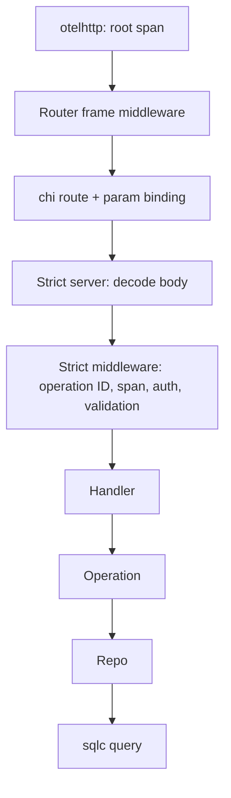

# A request, end to end

- **Order:** 4
- **Summary:** Every layer a request passes inside the container, what each one does, and where its errors go.

[From main to the first request](/docs/backend/boot-walkthrough) follows one request through the code. This page is the reference version: every layer in order, so you can find where something happens.

Before the request reaches the container, the API's Worker has already answered what it could at the edge. That part is in [Architecture](/docs/onboarding/architecture).



## 1. The router frame

`httpserver.NewRouter` puts these on every backend, outermost first. You don't add or remove any of them per backend (ADR-0018).

| Layer | What it does |
| --- | --- |
| `otelhttp` | Opens the request's root span. Skips `/health`, `/docs/openapi.yml` and CORS preflights. |
| `spanRouteNameMiddleware` | Renames the span to the route template, like `POST /forms/{form_id}/steps`, once chi has matched it |
| `realIP` | Works out the caller's real IP for the rate limiter and the logs: a front's `X-Client-IP` if it also sends the shared secret, else Cloudflare's `CF-Connecting-IP`, else the peer |
| `requestID` | Keeps a sane `X-Request-ID` from the caller, or makes a new one, and puts it on the response |
| `logs` | Writes one `http_request` log line per request |
| `metrics` | Counts and times each request by route and status |
| `recoverer` | Turns a panic into a logged 500, so one bad request can't take down the process |
| `timeout` | Cancels the request's context after 60 seconds |
| `maxBodySize` | Refuses bodies over 1 MB |
| `httpcache.Middleware` | Marks every response `private, no-store`, unless its operation is `x-cache: shared` |
| Rate limiter | A token bucket per client IP. `DISABLE_RATE_LIMIT` turns it off locally. |
| `CORS` | Answers preflights and sets the CORS headers. The backend does this itself, so it still works off Cloudflare. |

The frame also serves three routes of its own: `/health`, `/docs/openapi.yml` and `/problems/{slug}`.

## 2. The generated route

chi matches one of the routes that `openapi.Mount` registered. The generated wrapper parses the path and query parameters into their Go types. A parameter that doesn't parse is answered right here, through `httpserver.WriteParamError`.

`httpserver.OperationSlot` then puts an empty slot on the context. The strict middleware fills it with the operation's ID, so anything that writes a problem later knows which operation it came from.

## 3. The strict server

The generated strict handler decodes the JSON body into a typed request object, like `openapi.CreateStepRequestObject`. A body that doesn't decode is answered through `httpserver.WriteBodyError`.

Then it runs the request through the harness's strict middleware (`httpserver.StrictStack`). The last one in the list wraps outermost, so they run in this order:

| Order | Middleware | What it does |
| --- | --- | --- |
| 1 | `operationMiddleware` | Writes the operation ID into the slot |
| 2 | `TraceMiddleware` | Opens one span named after the operation, like `CreateStep`. Only a 5xx marks it failed, because a 4xx is the caller's mistake. |
| 3 | `AuthDispatch` | Runs the chain `d.Chains` built from the operation's `security` and `x-scope`. Public operations skip it. An operation with no chain at all fails closed with a 500. |
| 4 | `ValidateMiddleware` | Checks the body against its `validate` tags |

## 4. Handler, operation, repo

This part is the feature's own code. Each layer has one job:

| Layer | File | Its job |
| --- | --- | --- |
| Handler | `handlers.go` | Turn the generated request into the operation's input, and the result into a generated response. No rules. |
| Operation | `operations.go` | The rules: validation, the access check, transactions, calls to repos and other features |
| Repo | `repo.go` | Call sqlc, map rows to domain types, turn driver errors into named errors |

The handler is the only layer that knows about HTTP types, and the repo is the only one that knows about sqlc types. The operation in between works only with `models`, so you can test it without HTTP or a database. [Features](/docs/backend/features) has more on all three.

## 5. On the way out

A handler returns a generated response type, like `openapi.CreateStep201JSONResponse`, and the generated code writes it. Responses are plain JSON. A list is `{ "items": [...] }`, and an operation with nothing to return answers `204` (ADR-0017).

Any layer can return an error instead. Every one of them ends up in `httpserver.WriteError`:

1. The backend's mapper turns the error into its problem.
2. A 5xx gets its cause logged. The cause never goes in the response body.
3. The problem is checked against the operation's `x-problems`, and counted by its slug.
4. It's written as `application/problem+json`, with `type` set to `{API_URL}/problems/{slug}` and `instance` set to the path.

[Errors](/docs/backend/errors) covers how an error gets to be a problem.

## What a trace shows

Because the harness opens the spans, every request has the same shape in Grafana:

```
POST /forms/{form_id}/steps      ← otelhttp, renamed by route
└─ CreateStep                    ← TraceMiddleware
   └─ pgx queries                ← the database tracer, one span per query
```

Repos and operations don't open spans. A manual span is only worth adding for a single step you want to see on its own, like a call to a payment provider.
