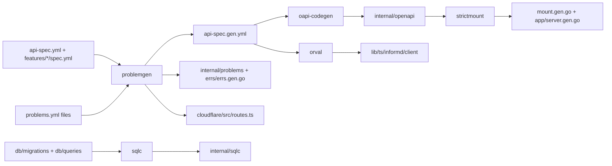

# The spec drives the code

- **Order:** 3
- **Summary:** Where a backend's spec lives, what just gen builds from it and from the SQL, and which files you write by hand.

A backend has two sources of truth: its OpenAPI spec and its SQL. Most of the code between them is generated from those two. You change the spec or the SQL, run `just gen`, and the Go compiler shows you everything that has to follow.

## Where the spec lives

Each backend's `api-spec.yml` holds what's shared: the API's description, its security schemes, and the schemas and parameters that more than one feature uses. Its `paths` only point to the features' own files:

```yaml
# api/informd/api-spec.yml
paths:
  # …
  /forms/{form_id}/steps:
    $ref: './internal/features/steps/spec.yml#/paths/~1forms~1{form_id}~1steps'
```

The feature's `spec.yml` holds the real operation, next to the Go code that serves it (ADR-0021):

```yaml
# api/informd/internal/features/steps/spec.yml
paths:
  /forms/{form_id}/steps:
    post:
      tags: [steps]
      operationId: createStep
      summary: Create a step
      security:
        - bearerAuth: []
      parameters:
        - $ref: '../../../api-spec.yml#/components/parameters/FormID'
      requestBody:
        # …
      x-problems: [400, 401, 403, 404, 500]
      responses:
        '201':
          # …
```

A feature's spec also holds the schemas and problems that only it uses. Problems used by several features of one backend go in that backend's `problems.yml`, and the ones every backend shares are in `api/problems.yml`.

## The extensions we use

The kit reads more from the spec than plain OpenAPI does. These are the extensions you'll run into:

| Extension | Where | What it does |
| --- | --- | --- |
| `x-problems` | an operation | The problems it can answer, as slugs or statuses. The bundle turns them into error responses, and the harness warns about (or panics on, in tests) any problem it answers that isn't listed. |
| `x-problem` | a schema | Declares a problem: its slug, status, title, and the Go error it comes from. See [Errors](/docs/backend/errors). |
| `x-shared-errors` | a backend's `problems.yml` | Named errors answered with a shared problem, like `ErrStepNotFound` answered as `not-found` |
| `x-scope` | an operation | Limits which kind of caller may use it |
| `x-cache: shared` | a public GET | Lets the edge cache the response until a write purges it. See [Jobs, caching and telemetry](/docs/backend/jobs-caching-telemetry). |

## What just gen builds

`just gen` runs sqlc once for every backend, then `tools/go/generate.sh` for each one, then the TypeScript clients and the Worker types:

```sh
# tools/go/generate.sh
go run tools/problemgen api-spec.yml api-spec.gen.yml internal/problems/problems.gen.go
oapi_codegen --config oapi-codegen.yaml -generate types -o internal/openapi/types.gen.go api-spec.gen.yml
oapi_codegen --config oapi-codegen.yaml -generate chi-server,strict-server -o internal/openapi/server.gen.go api-spec.gen.yml
go run tools/strictmount internal/openapi/mount.gen.go internal/app/server.gen.go
```



Step by step:

1. **sqlc** reads `db/migrations` as the schema and `db/queries/*.sql` as the queries, and writes typed Go into `internal/sqlc`. A query named `-- name: CreateStep :one` becomes `q.CreateStep(ctx, sqlc.CreateStepParams{…})`.
2. **problemgen** merges `api-spec.yml`, every feature's `spec.yml` and both `problems.yml` files into one file, `api-spec.gen.yml`. It writes the problems package (one constructor per problem, `Docs` and the `Mapper`) and the named errors in `errs/errs.gen.go`. It also writes the list of path prefixes the Worker checks before waking the container. That list is committed, and a test fails when it no longer matches the spec.
3. **oapi-codegen** reads the bundle and writes the request and response types, the chi routes and the strict server interface into `internal/openapi`.
4. **strictmount** writes `Mount`, which serves the strict server through the harness, and `internal/app/server.gen.go`, which embeds every feature's `Handlers` into one `server` type.
5. **orval** (`just gen-ts`) writes the TypeScript client for each API into `lib/ts/<api>/client`, for the apps to use.

Git ignores all of this except the Worker's route list. CI and the Dockerfiles run the same script, so what you generate locally is what gets deployed. If an import is missing after a pull, run `just gen`.

## What you write by hand

| You write | Generated from it |
| --- | --- |
| A feature's `spec.yml` | Routes, request and response types, the strict server interface, the TS client |
| An `x-problem` in a spec | The Go error in `errs/errs.gen.go`, its problem constructor and its case in the mapper |
| A migration in `db/migrations` | sqlc's models |
| A query in `db/queries` | Its typed Go method |
| `handlers.go`, `operations.go`, `repo.go` | Nothing. This is the code that's yours. |

## How the compiler helps

Since the generated server is an interface, adding an operation to a spec breaks the build until some feature's `Handlers` has a method for it. Renaming a column breaks every repo that reads it. Removing an `x-problem` removes its Go error, so every place that returns it stops compiling.

That's the point of all this generation. The spec and the SQL are the contract, and the compiler checks the code against them, so you don't have to remember to.
