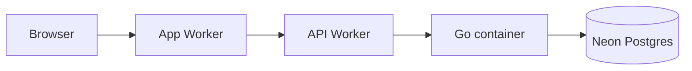

# Architecture

- **Order:** 7
- **Summary:** How a request reaches an API in production, and how background jobs run.

Everything runs on Cloudflare. The databases are Postgres on Neon.

## A request, step by step

A Worker is a small program Cloudflare runs close to the user.

1. The browser loads an app from its app Worker. The app's server code calls the APIs, so the browser never calls them directly.
2. Each API has an API Worker in front of it. Its code is in `api/<api>/cloudflare`.
3. The API Worker passes the request to a container, which runs the same Go image you run locally.
4. The container reads and writes Postgres on Neon.

## Where it runs

| Product | API | App |
| --- | --- | --- |
| IdentityX | `api.identityx.trieoh.com` | `dev.identityx.com.br` |
| Payssage | `api.payssage.trieoh.com` | `dev.payssage.trieoh.com` |
| Informd | `api.informd.trieoh.com` | `dev.informd.trieoh.com` |
| Univents | `api.univents.com.br` | `dev.univents.com.br` |

## Containers sleep

A container stops after two minutes without requests. The next request wakes it again, which is called a cold start and makes that request slower.

The four containers share a monthly limit of awake time. When it runs out, no container starts until the next billing cycle. The portal's Metrics page shows how much is left. This is also why the portal never calls the APIs: each call would wake a container.

## Background jobs

Some work runs after the response, like sending an email. Locally, jobs run inside the API process. In production:

1. The container hands the job to its API Worker.
2. The Worker puts it on a Cloudflare Queue.
3. The queue hands it back to the Worker, which sends it to the container's `/_jobs` endpoint.

A job that keeps failing ends up in a dead-letter queue, a separate queue for failed jobs. Scheduled jobs, like the daily key rotation, are started by a cron on the API Worker.

## Errors and telemetry

Every API returns errors in the same shape (RFC 9457) and lists them in its `problems.yml`. The portal builds its Problems pages from those files.

The APIs send traces, metrics and logs to Grafana Cloud.

## Why it's built this way

Each choice has a decision record in `docs/adr/`, shown in the portal under Docs, then Decisions. ADR-0011 explains why the APIs run on Cloudflare Containers. Start there.
