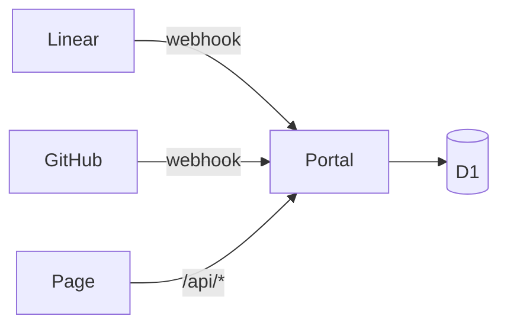

# Writing docs

- **Order:** 9
- **Summary:** How portal docs are written, and every component they can use.

Portal docs are Markdown or MDX files in the repo. They're built with the portal, so a doc changes when the portal is released.

| Folder | Shows up under |
| --- | --- |
| `docs/onboarding/` | Docs → Onboarding |
| `docs/backend/` | Docs → Backend |
| `docs/runbooks/` | Docs → Runbooks |
| `docs/incidents/` | Docs → Incident reports |
| `docs/adr/` | Docs → Decisions |
| `docs/services/<service>/consumer/` | The service's docs, under Consumer |
| `docs/services/<service>/maintainer/` | The service's docs, under Maintainer |

## Service docs

Each service has its own docs page, opened from the Docs button on the service or from Services in the Docs menu. Pages are split in two:

- **Consumer** pages are for the apps and services that call it.
- **Maintainer** pages are for whoever changes the service itself.

Inside each half, `**Group:** Signing in` lists a page under that heading, and `**Order:**` sets the reading order. A group shows up where its first page sits in that order. Each page's slug comes from its file name, so keep file names unique across both folders of a service.

The service's docs page also lists, on its own, the decisions whose `scope` names the service and the incident reports whose `services` include it.

## Shape of a doc

Start with a `# Title`. A list of `**Field:** value` lines right under it becomes the page's header and is left out of the body, the way the ADRs carry their status and date. `**Order:** 3` sets where a doc sits in its folder's list; docs without one come after, by title. Everything after that is ordinary Markdown: `##` sections get anchors you can link to, tables, and fenced code highlighted in both themes.

```ts
// front/portal/src/server.ts
if (path === "/api/issues") {
  return json(await readIssues(env.DB));
}
```

## Callouts

<Callout title="Good to know">A note, the default type.</Callout>

<Callout type="tip">Tips are for shortcuts worth taking.</Callout>

<Callout type="warning" title="Wakes the API">Calling `/health` starts a container that would otherwise stay asleep.</Callout>

<Callout type="danger">Danger is for steps that lose data or money.</Callout>

## Cards

<Cards>
  <Card title="Decisions" href="/docs/decisions">Why things are the way they are.</Card>
  <Card title="TheTree on GitHub" href="https://github.com/TrieOH/TheTree">The code, the tags and the CI runs.</Card>
</Cards>

## Steps

<Steps>

### Write the doc

Add a `.mdx` file to one of the folders above.

### Open a pull request

Like any other change, scoped `docs`.

### Release the portal

Docs ship with the next `portal-ui` tag.

</Steps>

## Tabs

<Tabs labels={["API", "Front"]}>
  <Tab>

```sh
just run identityx
```

  </Tab>
  <Tab>

```sh
pnpm -F identityx dev
```

  </Tab>
</Tabs>

## Diagrams

Fence a block as `mermaid`:



## Problems

`<Problems service="…" />` lists the RFC 9457 problems a service can answer, read from its `problems.yml` when the portal is built. By default it groups them by status, leaves the shared ones to a link, and keeps descriptions on each problem's own page. Every row expands to the problem's members and an example body.

| Option | Default | What it does |
| --- | --- | --- |
| `service` | (required) | A service, or `"shared"` for the problems every service answers |
| `shared` | `"link"` | `"include"` lists the shared problems too; `"hide"` drops the link |
| `only` | every problem | `only={["provider-conflict"]}` shows just those slugs |
| `group` | `true` | `group={false}` gives one flat list |
| `open` | `false` | `open` keeps every row's details open, with no toggle |
| `description` | `"page"` | `"inline"` shows descriptions in the list too; one that only restates the title is never shown |

<Problems service="payssage" />

A single problem, open:

<Problems service="payssage" only={["provider-unauthorized"]} open description="inline" />
