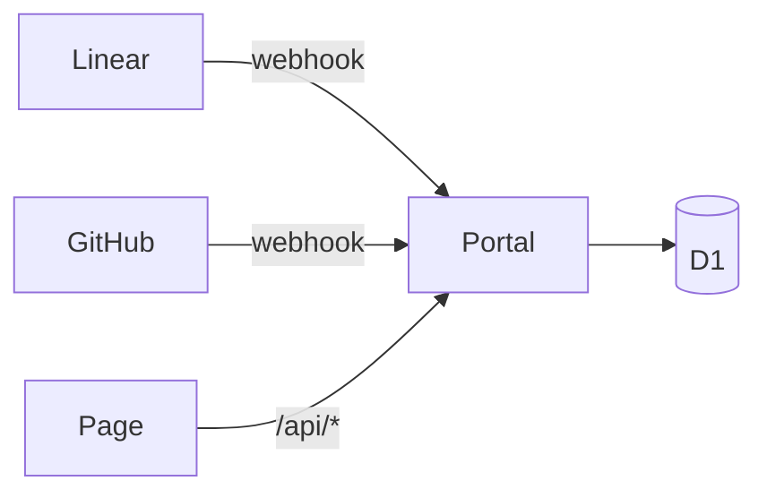

# Writing docs

- **Summary:** How portal docs are written, and every component they can use.

Portal docs are Markdown or MDX files in the repo. They're built with the portal, so a doc changes when the portal is released.

| Folder | Shows up under |
| --- | --- |
| `docs/onboarding/` | Docs → Onboarding |
| `docs/runbooks/` | Docs → Runbooks |
| `docs/incidents/` | Docs → Incident reports |
| `docs/adr/` | Docs → Decisions |

## Shape of a doc

Start with a `# Title`. A list of `**Field:** value` lines right under it becomes the page's header and is left out of the body, the way the ADRs carry their status and date. Everything after that is ordinary Markdown: `##` sections get anchors you can link to, tables, and fenced code highlighted in both themes.

```ts
// front/portal/src/server.ts
if (path === "/api/issues") {
  return json(await readIssues(env.DB));
}
```

## Callouts

<Callout title="Good to know">A note, the default type.</Callout>

<Callout type="tip">Tips are for shortcuts worth taking.</Callout>

<Callout type="warning" title="Wakes the API">Calling `/health` starts a container that would otherwise stay asleep.</Callout>

<Callout type="danger">Danger is for steps that lose data or money.</Callout>

## Cards

<Cards>
  <Card title="Decisions" href="/docs/decisions">Why things are the way they are.</Card>
  <Card title="TheTree on GitHub" href="https://github.com/TrieOH/TheTree">The code, the tags and the CI runs.</Card>
</Cards>

## Steps

<Steps>

### Write the doc

Add a `.mdx` file to one of the folders above.

### Open a pull request

Like any other change, scoped `docs`.

### Release the portal

Docs ship with the next `portal-ui` tag.

</Steps>

## Tabs

<Tabs labels={["API", "Front"]}>
  <Tab>

```sh
just run identityx
```

  </Tab>
  <Tab>

```sh
pnpm -F identityx dev
```

  </Tab>
</Tabs>

## Diagrams

Fence a block as `mermaid`:



## Problems

`<Problems service="payssage" />` lists every problem a service can answer, read from its `problems.yml`:

<Problems service="payssage" />
