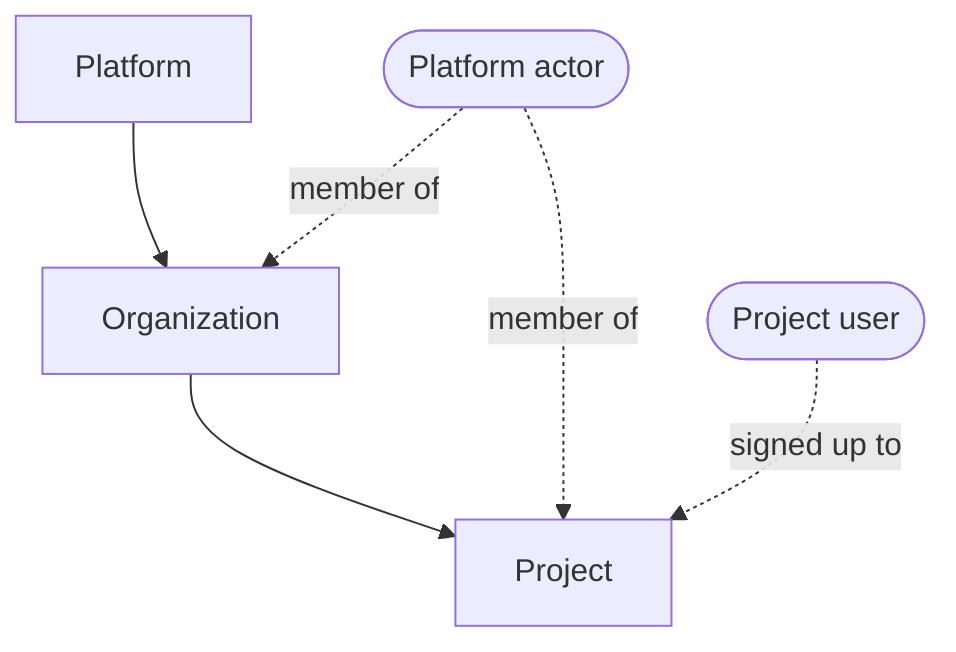

# Concepts

- **Order:** 2
- **Group:** Start here
- **Summary:** Actors, organizations, projects, roles and API keys, and how they fit together.

IdentityX has three levels. The **platform** is IdentityX itself. Inside it are **organizations**, and inside each organization are **projects**.

## Actor

An actor is anything that can sign in. There are three types: `human`, `service` and `machine`. Most actors are people (`human`).

Each actor is created in one place:

- A **platform actor** is created on IdentityX itself, with no project. Developers who create organizations and projects are platform actors.
- A **project actor** is created inside one project. Someone who signs up to an app built on that project is a project actor.

The same email in two projects gives two separate actors, each with its own password and profile.

## Organization

An organization holds projects and has members. Each member has one role: `member`, `admin` or `owner`.

## Project

A project is a workspace inside an organization, usually for one app. A project has its own:

- users, who sign up to the app
- signing keys, separate from every other project
- login providers, email templates and terms of service
- profile fields and API keys

## Project user and project member

| | Project user | Project member |
| --- | --- | --- |
| Who | Someone who signed up to the app | Someone who works on the project |
| Kind of actor | A project actor | A platform actor |
| Role in the project | None | `member`, `admin` or `owner` |

A platform actor never belongs to a project, but it can work on one as a member.

Someone can also get a project role from the organization. When a person has no role set on the project itself, their organization role counts in each of the organization's projects. A role set on the project always wins.

## Roles

The word `admin` appears in more than one list, so each role belongs to a level:

| Level | Roles | Gives |
| --- | --- | --- |
| Organization | `member`, `admin`, `owner` | Access to the organization, and to its projects that set no role |
| Project | `member`, `admin`, `owner` | Access to that one project |
| Platform | `support`, `admin`, `super_admin` | Access to IdentityX itself, and no role in any organization or project |

Some routes are only for platform actors, like creating an organization or a project. The API reference shows them with `scope platform-only`. A project user who calls one gets the `platform-only` problem.

## API key

An API key is a long-lived secret for a caller with no person behind it, like a backend or a script. It belongs to a project, and it acts as the actor it was made for, with the capabilities it was given. A key can have an end date.

The caller sends it in the `X-API-KEY` header.
